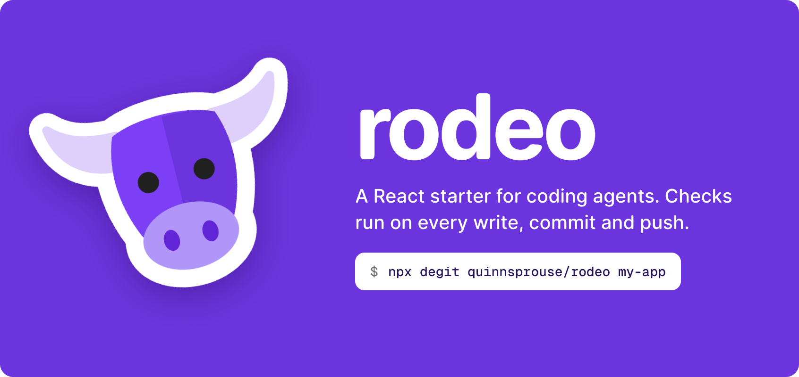
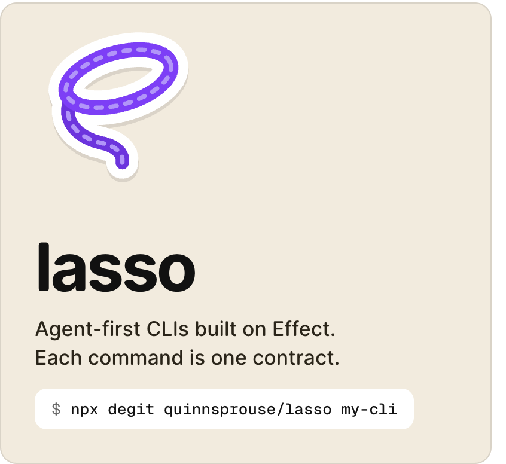
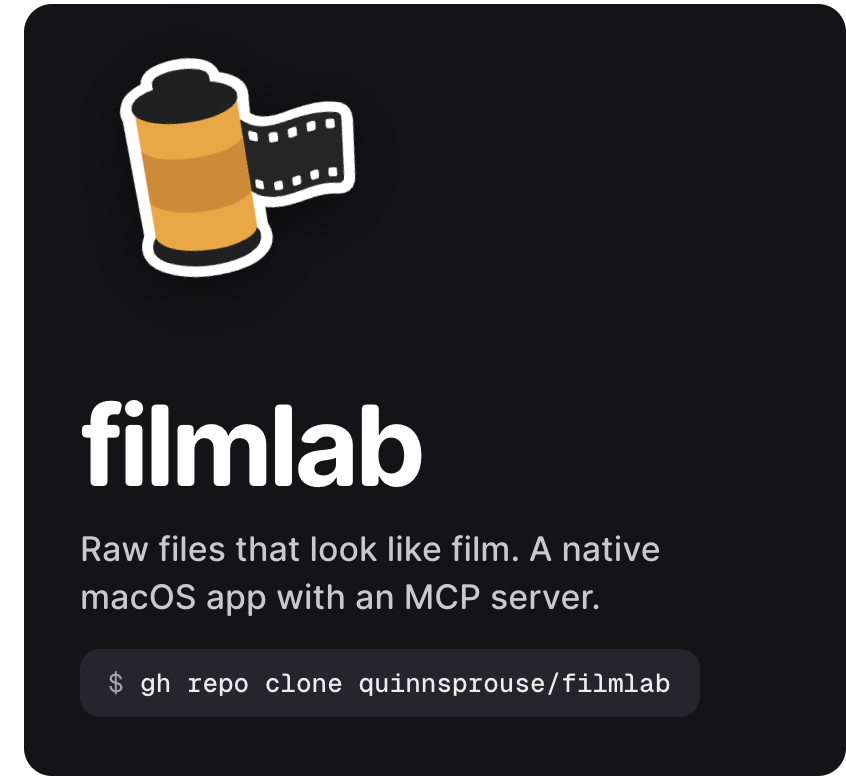
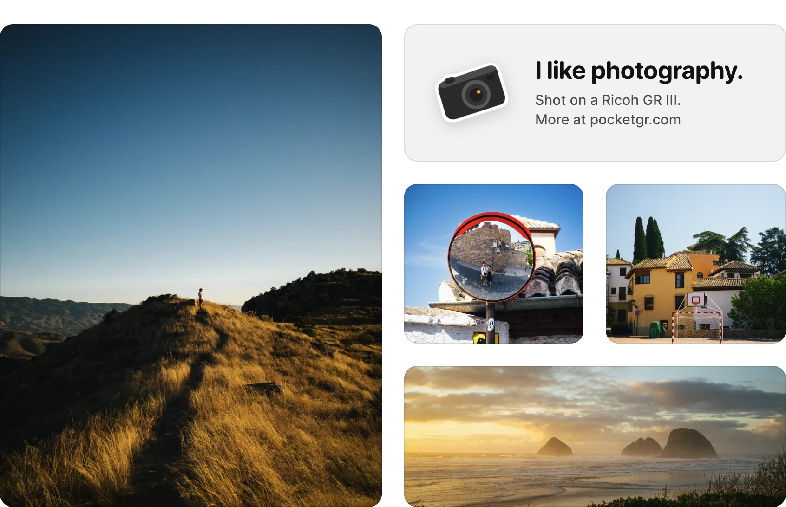

# I'm Quinn.

I build tools that help coding agents write real software. Away from the keyboard, I'm usually out with a camera.

<a href="https://github.com/quinnsprouse/rodeo"><picture><source media="(prefers-color-scheme: dark)" srcset="assets/rodeo-dark.png"></picture></a>

<a href="https://github.com/quinnsprouse/lasso"><picture><source media="(prefers-color-scheme: dark)" srcset="assets/lasso-dark.png"></picture></a><a href="https://github.com/quinnsprouse/filmlab"><picture><source media="(prefers-color-scheme: dark)" srcset="assets/filmlab-dark.png"></picture></a>

<a href="https://www.pocketgr.com"><picture><source media="(prefers-color-scheme: dark)" srcset="assets/photos-dark.webp"></picture></a>

Smaller tools and experiments

- [routecraft](https://github.com/quinnsprouse/routecraft): a CLI for agents that build explicit bicycle routes
- [whoop-cli](https://github.com/quinnsprouse/whoop-cli): an unofficial WHOOP CLI for sign-in and data export
- [trainerroad-cli](https://github.com/quinnsprouse/trainerroad-cli): a TrainerRoad CLI built for agent-friendly queries
- [expo-starter](https://github.com/quinnsprouse/expo-starter): an Expo SDK 55 starter with HeroUI Native, Uniwind, TanStack Query and Zod
- [typling](https://github.com/quinnsprouse/typling): a keyboard-driven tool for memorizing text by typing it
- [bible-to-markdown](https://github.com/quinnsprouse/bible-to-markdown): a fast CLI that converts Bible text to Markdown

